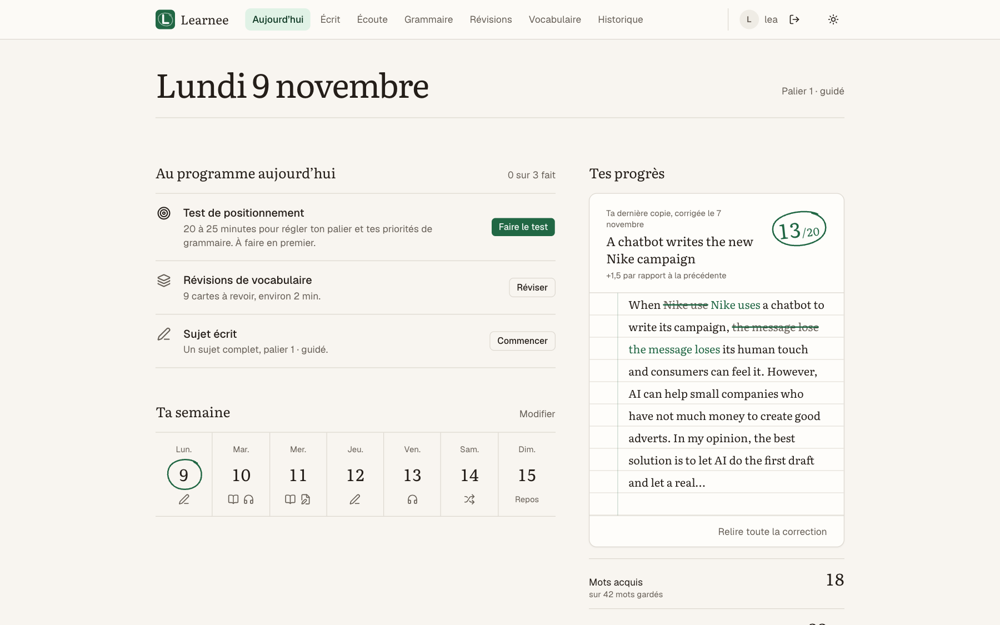
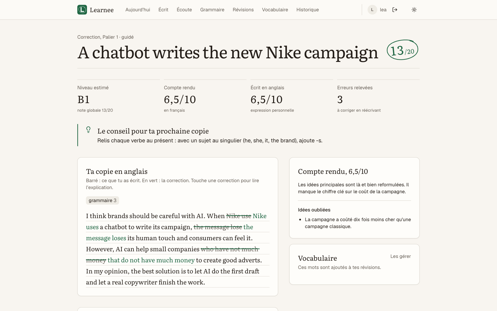
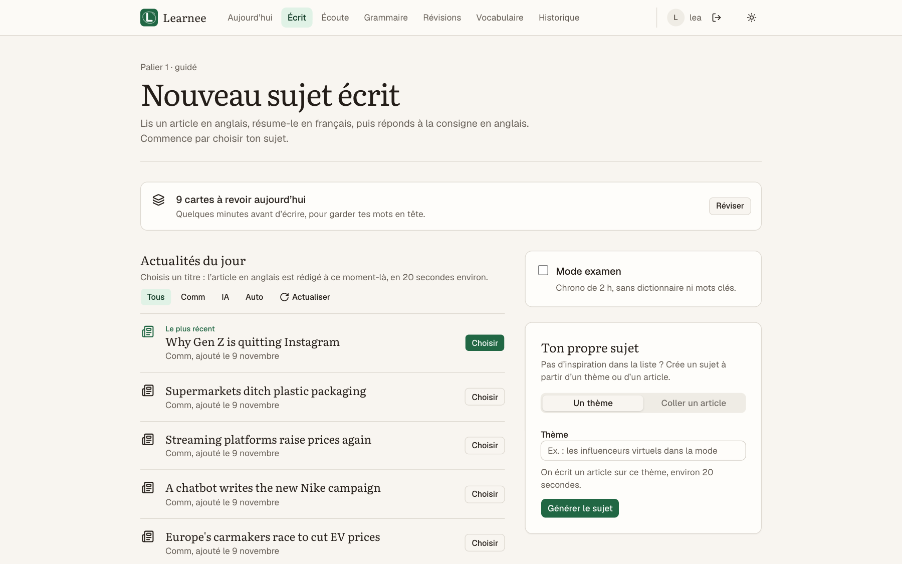
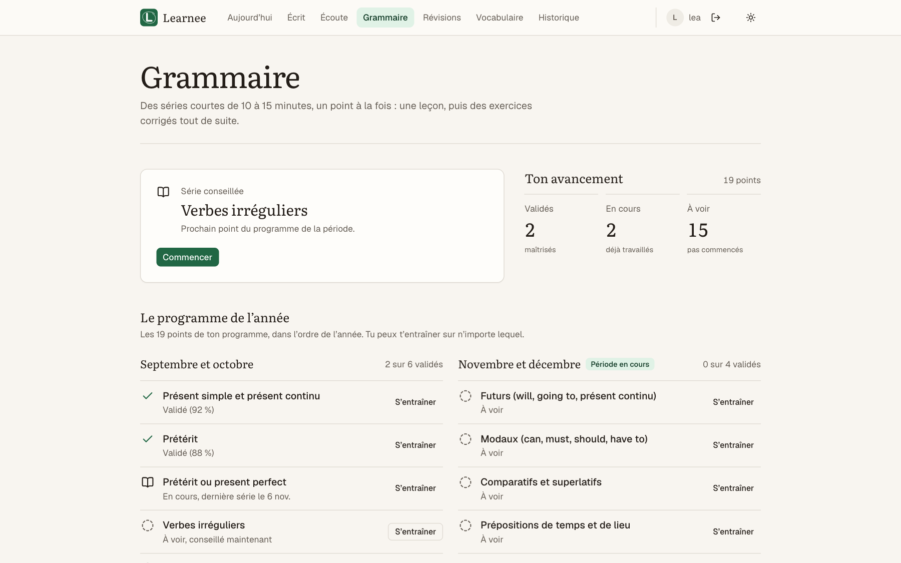
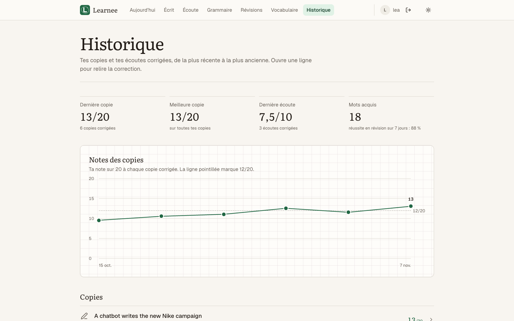
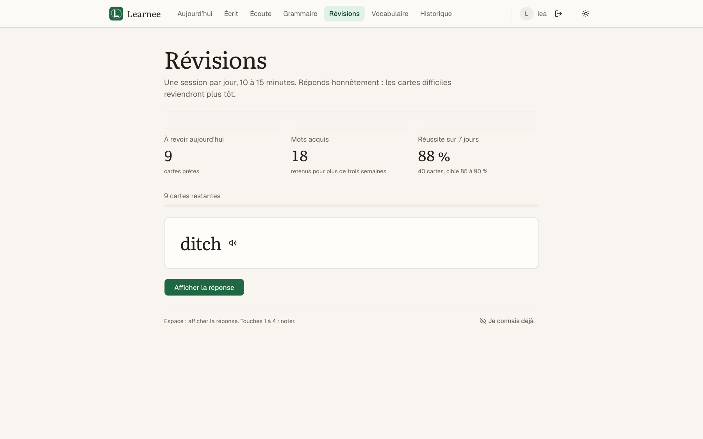
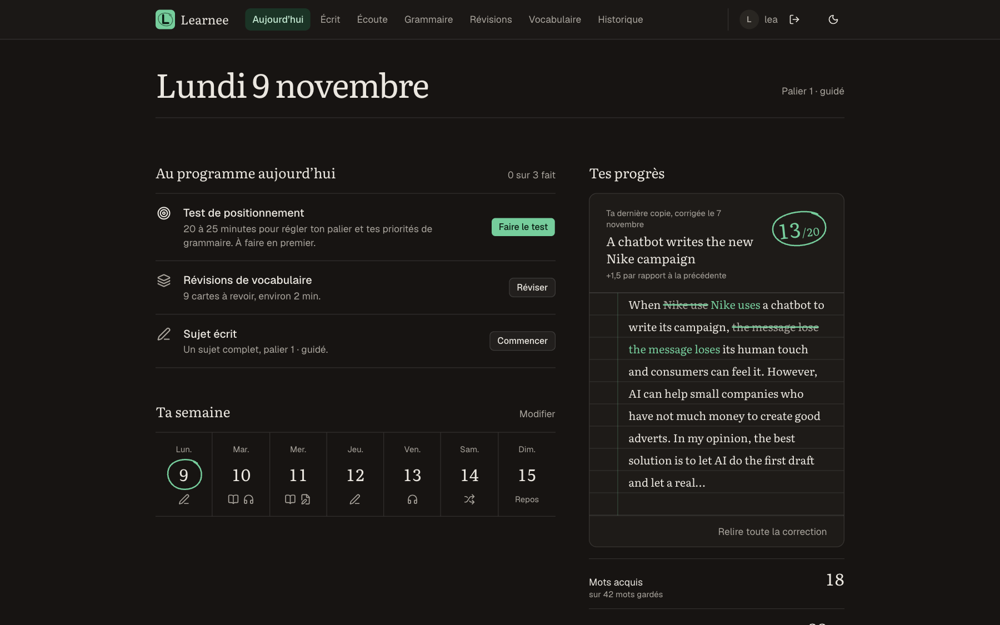
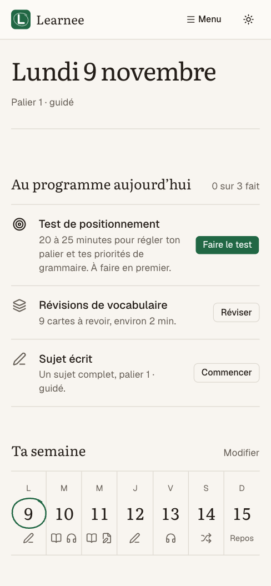
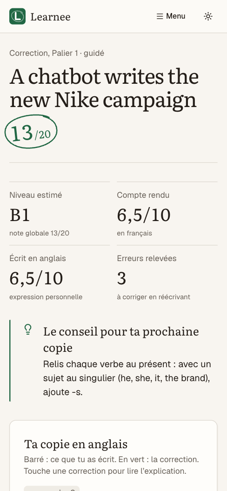

<p align="center">
  
</p>

<h1 align="center">Learnee</h1>

<p align="center">
  <strong>Lire, résumer, écrire : un coach de langue qui corrige tout de suite.</strong><br>
  Un programme court chaque jour, des copies notées sur 20, et le niveau qui monte par paliers.
</p>

<p align="center">
  
  
  
  
  
  <br>
  
  
  
  
  
  <a href="LICENSE"></a>
</p>

<p align="center">
  
</p>

Application web d'entraînement en langue étrangère, pour **n'importe quelle langue** et un objectif au choix :
**BTS Communication** (épreuve E21 d'anglais), **certification** (TOEIC, TOEFL, IELTS, DELE, Goethe…),
**baccalauréat**, **niveau B2 général**, **usage professionnel** ou un **objectif personnel** décrit en une phrase.
L'exercice central : lire un article dans la langue étudiée, en faire le compte rendu en français, puis répondre à une
consigne dans la langue étudiée. Learnee propose chaque jour un programme court (écrit, grammaire, écoute, révisions
de vocabulaire), corrige tout de suite et fait monter le niveau par paliers. L'interface reste en français.

Pensée pour **un seul compte élève** (plus des comptes en lecture seule pour suivre les progrès), auto-hébergeable sur un
petit serveur ou un NAS, avec un coût d'usage de quelques centimes par mois.

La spécification complète est dans [`docs/redac-b2-spec.md`](docs/redac-b2-spec.md), le système de design dans
[`docs/design.md`](docs/design.md).

## Aperçu

<table>
  <tr>
    <td width="50%"><br><sub><b>Correction</b> : note entourée, conseil en marge, erreurs barrées et corrigées à l'encre verte, comme une copie rendue.</sub></td>
    <td width="50%"><br><sub><b>Écrit</b> : un sujet tiré des actualités du jour, d'un thème ou d'un article collé.</sub></td>
  </tr>
  <tr>
    <td><br><sub><b>Grammaire</b> : le programme de l'année, point par point.</sub></td>
    <td><br><sub><b>Historique</b> : la courbe des notes et toutes les copies corrigées.</sub></td>
  </tr>
  <tr>
    <td><br><sub><b>Révisions</b> : répétition espacée (FSRS) des mots gardés.</sub></td>
    <td><br><sub><b>Thème sombre</b>, pour les longues séances du soir.</sub></td>
  </tr>
</table>

<p align="center">
  
  &nbsp;&nbsp;
  
  <br><sub>Pensée aussi pour le téléphone.</sub>
</p>

<sub>Captures faites avec un compte et des données de démonstration.</sub>

## Fonctionnalités

- **Ton objectif** (`/objectif`), à la première connexion : langue étudiée, objectif, niveau visé (B1, B2, C1) et
  1 à 4 thèmes d'actualité. Modifiable depuis le profil. Pour une nouvelle langue, le programme de grammaire et les
  verbes à retenir sont préparés une seule fois par le modèle, puis gardés ; les thèmes sont traduits en recherches
  d'actualités dans la langue étudiée. Une installation déjà utilisée sans profil garde l'anglais / BTS Communication.
- **Aujourd'hui** : programme du jour, semaine type, progrès (mots acquis, notes, niveau par compétence), frise des
  3 paliers, actualités du jour, points à travailler.
- **Écrit** : sujet à partir d'une actualité du jour, d'un thème ou d'un article collé ; rédaction du compte rendu et
  de l'écrit (mode examen chronométré en option) ; définition d'un mot en le touchant ou en le sélectionnant ;
  correction notée sur 20 avec les erreurs expliquées, une version améliorée et une réécriture guidée.
- **Écoute** : audio généré à plusieurs voix dans la langue étudiée (à partir d'une actualité ou d'un thème) ou audio réel
  importé et transcrit ; 3 écoutes maximum, prise de notes, compte rendu en français, correction et transcription.
- **Grammaire** : un programme de 15 à 20 points répartis sur l'année (19 points écrits à la main pour l'anglais) ; chaque série commence par une leçon (règle, exemples, pièges
  pour un francophone) puis 12 exercices en 6 formats ; un point est validé après deux séries à 85 % ou plus.
- **Révisions** : répétition espacée (FSRS) des mots gardés, en QCM ; verbes irréguliers ou courants de la langue
  ajoutés chaque semaine ; export CSV pour Anki.
- **Test de positionnement** (grammaire, lecture, écrit, écoute) qui règle le palier de départ et les priorités,
  **examens blancs** à partir de janvier, **bilan de la semaine** (page ou e-mail).
- **Visite guidée** animée à la première connexion, **suivi en direct** des générations longues.
- **Comptes** : élève, ou lecture seule (voit tout, ne modifie rien).

## Stack

Next.js 16 (App Router), React 19, TypeScript, Tailwind CSS 4, shadcn/ui, SQLite (better-sqlite3), zod,
ts-fsrs, node-cron, modèles de langage via [OpenRouter](https://openrouter.ai) (SDK openai), audio via
[ElevenLabs](https://elevenlabs.io) et ffmpeg, tests avec Vitest.

## Démarrage en local

Prérequis : Node.js 22, pnpm 11, ffmpeg pour l'audio (`brew install ffmpeg` sur macOS).

```bash
cp .env.example .env.local        # renseigner au moins OPENROUTER_API_KEY
pnpm install
pnpm dev                          # http://localhost:3000 (crée la base data/app.db au premier lancement)
pnpm user:add eleve student         # dans un autre terminal : compte élève (le mot de passe est demandé)
pnpm user:add parent viewer       # compte en lecture seule
```

Relancer `user:add` avec un identifiant existant change son mot de passe et déconnecte ses appareils.

## Configuration

Toute la configuration passe par des variables d'environnement, décrites dans [`.env.example`](.env.example).

| Variable | Rôle |
|---|---|
| `OPENROUTER_API_KEY` | Clé OpenRouter (obligatoire). |
| `LLM_MODEL_GENERATE`, `LLM_MODEL_CORRECT` | Modèles payants pour les générations et les corrections. |
| `LLM_MODEL_<TÂCHE>` | Modèle par tâche (`DEFINE`, `GRAMMAR_SET`, `PLACEMENT`…). Une liste séparée par des virgules donne des modèles de secours. |
| `LLM_SERVICE_TIER` | `flex` pour le tarif OpenAI réduit, avec repli automatique au tarif normal. |
| `ELEVENLABS_API_KEY`, `ELEVENLABS_VOICES` | Audio des écoutes et prononciation. Sans clé, ces fonctions sont désactivées proprement. |
| `SMTP_URL`, `SMTP_FROM`, `REPORT_TO` | Envoi du bilan de la semaine par e-mail (facultatif). |
| `JOBS_ENABLED`, `TZ` | Tâches planifiées et fuseau horaire. |
| `TRUSTED_IP_HEADER` | En-tête du proxy qui porte l'IP du visiteur (déjà réglé dans les fichiers compose). |

### Coûts

Rien de payant ne tourne tout seul : tout part d'un clic.

- **Gratuit** : titres d'actualité (flux RSS, sans IA), définitions de mots, conseil du bilan, mise en contexte des
  écoutes (modèles `:free`).
- **Payant** (environ 0,05 à 0,1 centime par appel avec `openai/gpt-6-luna` en `flex`) : rédaction d'un sujet, série de
  grammaire, test de positionnement, script d'écoute, corrections.
- **ElevenLabs** : environ 800 à 1 400 caractères par écoute selon la période (modèle Flash) ; l'offre gratuite
  suffit pour une dizaine d'écoutes par mois. La prononciation d'un mot est mise en cache.
- Garde-fous : 30 appels au modèle par heure (60 pour les définitions). Pense aussi à fixer une limite mensuelle
  dans OpenRouter et ElevenLabs.

Chaque appel est journalisé (`[llm] tâche modèle tier ok durée tokens coût`) et enregistré dans la table `llm_calls`.

## Déploiement

L'image Docker ([`Dockerfile`](Dockerfile)) produit un serveur Next.js autonome avec ffmpeg, lancé sans root (utilisateur
`node`, uid 1000). Les données (base SQLite et fichiers audio) vivent dans le volume `/data` : le dossier `./data` de l'hôte
doit appartenir à l'uid 1000 (`sudo chown -R 1000:1000 data`, fait automatiquement par `deploy/nas/deploy.sh`).

**Serveur avec un nom de domaine** : [`compose.yaml`](compose.yaml) lance l'app derrière Caddy (HTTPS automatique).

```bash
cp .env.example .env              # clés et DOMAIN
docker compose up -d --build
docker compose exec app node scripts/user-add.mjs eleve student
```

**NAS ou serveur derrière un tunnel Cloudflare** : [`deploy/nas`](deploy/nas) lance l'app seule sur le port 3100, joignable
depuis le NAS uniquement ; le tunnel existant route un nom d'hôte vers `http://localhost:3100`. Mise à jour depuis le poste de dev :

```bash
deploy/nas/deploy.sh root@<ip-du-nas>   # envoie le dernier commit et .env.local, reconstruit, garde les données
```

**Sauvegarde** : copier `data/app.db` (avec `sqlite3 data/app.db ".backup …"`) et le dossier `data/audio/`, par exemple
chaque nuit par cron.

## Sécurité

- Mots de passe hachés avec scrypt, sessions par jeton aléatoire (haché en base, cookie `HttpOnly`, `SameSite=Lax`,
  `Secure` en HTTPS), renouvellement glissant sur 30 jours.
- Anti-force brute : 5 échecs en 15 minutes ou 20 en 24 heures bloquent un couple identifiant + adresse IP ; 20 échecs
  par heure bloquent une adresse IP. L'IP est lue uniquement dans l'en-tête du proxy de confiance (`TRUSTED_IP_HEADER`).
  Les échecs sont journalisés. Limites : sans `TRUSTED_IP_HEADER`, tous les visiteurs partagent la même « IP » et
  quelqu'un qui connaît l'identifiant peut bloquer le compte ; c'est aussi le cas d'une personne derrière la même IP
  (même box, même réseau). Une attaque répartie sur beaucoup d'IP obtient plus d'essais par jour : un mot de passe
  long et Cloudflare Access (ci-dessous) restent la vraie protection.
- Protection CSRF sur les requêtes qui modifient des données, contrôle du rôle sur chaque route, requêtes SQL
  paramétrées, en-têtes de sécurité (pas d'affichage en iframe, `nosniff`…).
- Aucune clé dans le dépôt : tout passe par `.env.local` / `.env`, ignorés par Git.

Conseil : derrière Cloudflare, ajoute Cloudflare Access (code par e-mail) devant l'app pour qu'aucun robot n'atteigne
la page de connexion.

## Développement

```bash
pnpm test                 # tests Vitest (base SQLite en mémoire, modèles et audio simulés)
pnpm lint
pnpm exec tsc --noEmit
pnpm build
```

```
src/
  app/          pages (App Router) et routes API
  components/   interface (shadcn/ui, composants de page, visite guidée)
  lib/
    services/   logique métier (correction, grammaire, écoute, positionnement…)
    repo/       accès à la base SQLite
    llm/        client OpenRouter (modèles de secours, flex, quotas, streaming)
    prompts/    prompts des modèles
    audio/      ElevenLabs, ffmpeg
    news/       titres d'actualité (flux RSS)
    db/         connexion et migrations
scripts/        création des comptes
deploy/nas/     déploiement sur un NAS
docs/           spécification et système de design
```

## Licence

Distribué sous licence [MIT](LICENSE).
